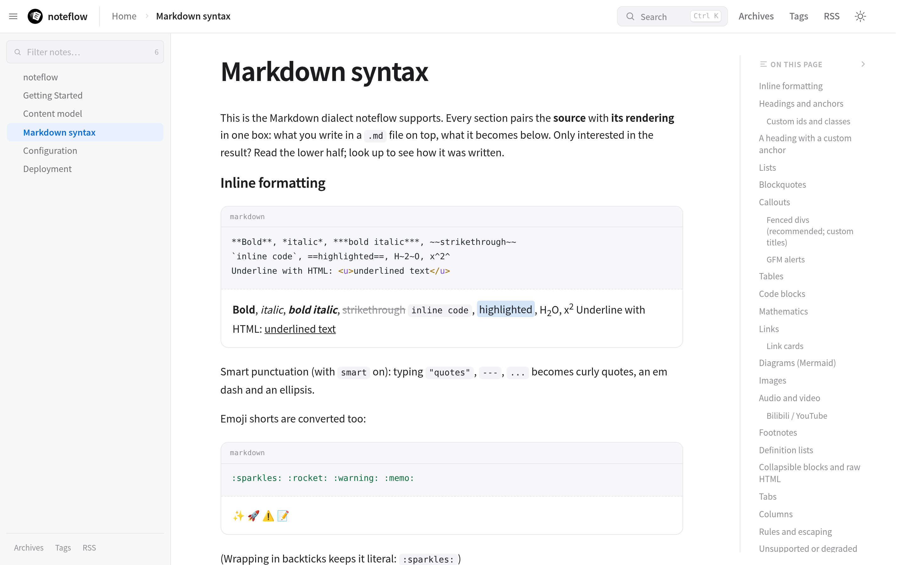
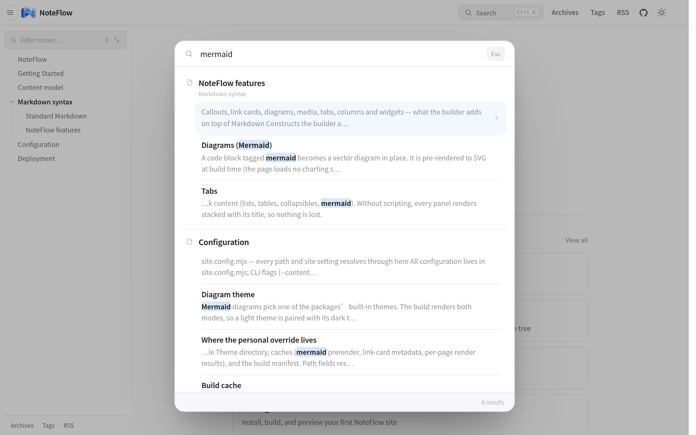
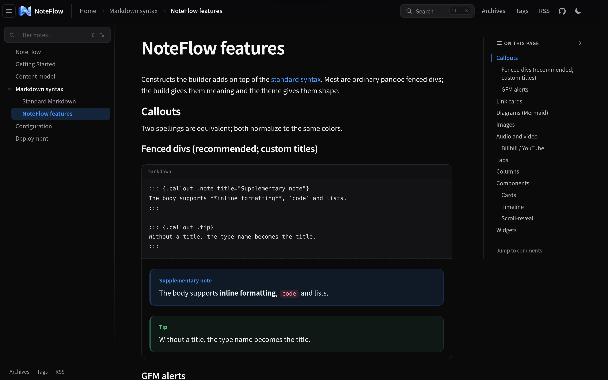

<div align="center">
  
</div>

<p align="center">
  <a href="https://gogongxt.github.io/noteflow/" title="Live demo + docs — this site is NoteFlow building its own documentation">Live demo + docs</a>
</p>

A static site generator for a personal knowledge base. Write Markdown in your own
git repository and publish only what you mark public — the directory tree becomes
the sidebar, and everything else stays private by construction.

<!-- The screenshots below are generated from the docs site. -->



| Search matches sections, not just pages | The same page under the dark theme |
| --- | --- |
|  |  |

**[Browse the live demo + docs →](https://gogongxt.github.io/noteflow/)** — the site is NoteFlow
building its own documentation in [`docs/`](./docs), so it doubles as the demo.
More screenshots in [`assets/shots/`](./assets/shots).

## Quick start

```bash
git clone https://github.com/gogongxt/noteflow.git
cd noteflow
npm install

./start.sh doctor              # check node / pandoc / content
./start.sh build               # build to dist/
./start.sh serve               # local preview at http://localhost:7060
./start.sh watch               # rebuild + preview while you edit
npm run build:docs             # build the docs site (docs/, site.config.docs.mjs)
npm test                       # full test suite (includes a real build)
```

Without a content directory of your own, the build falls back to `docs/` — this
documentation tree, which doubles as the demo.

**No toolchain?** The container brings its own — Node, pandoc, Chromium:

```bash
docker run --rm -p 8080:8080 -v "$PWD/notes:/app/notes:rw" ghcr.io/gogongxt/noteflow:latest
```

It builds the mounted notes on every start and serves them at
<http://localhost:8080>. See [Docker in the deployment guide](https://gogongxt.github.io/noteflow/posts/211fd193).

## What it is

You keep everything — drafts, private notes, published posts — in one Markdown
tree under version control. NoteFlow turns that tree into a fast static site:

- **Directory tree = sidebar.** `x.md` beside an `x/` directory is the standard page-with-children form; `_index.md` customizes a directory's landing page; `sort.txt` pins ordering.
- **Privacy by physical exclusion.** Only notes with `public: true` are built; everything else (and its attachments) never enters `dist/`. Private content cannot leak through search, feeds, or archives because it is simply not there.
- **Stable URLs.** Every note gets a CRC32-based `abbrlink` written into its frontmatter on its first build; the URL `/posts/<abbrlink>` then survives renames and reorganization.
- **The site can follow the notes repository.** A `sync` block in the config turns the serving host into a git mirror: clone on first start, poll the remote, rebuild when the branch tip moves. Edit anywhere, `git push`, the site catches up.
- **pandoc-powered Markdown.** A long-lived `pandoc server` converts content; the Node side does link rewriting, sanitizing, and template rendering. Mermaid diagrams are pre-rendered in headless Chromium at build time; audio and video use native `<audio>`/`<video>` with content-addressed attachments, so no player library is needed under strict CSP.
- **Security-first output.** Strict CSP (no inline scripts/styles except build-time sha256-hashed ones), no CDN, no external fonts, fail-closed builds (broken links and private-content leaks abort the build). The local preview serves the exact same security headers as production nginx.

### Scope: publishing, not editing

NoteFlow owns the **publish** side of a knowledge base. Authoring stays in whatever
writes Markdown — your editor, an agent, a script. There is no built-in WYSIWYG
editor, no backend, and no database: the source of truth is the git repository,
and the site is a pure function of it. (The preview server exists to look at the
result, not to edit.)

## Requirements

- **Node.js ≥ 22.18** (TypeScript runs on Node's native type stripping — no build step)
- **pandoc ≥ 3.0** with server support (`pandoc --version | grep server`)
- Headless Chromium (optional; only needed when content contains mermaid diagrams — `npx playwright-core install chromium`)

## Configuration

Everything lives in [`site.config.mjs`](./site.config.mjs): site name, URL, language, the content directory, page sizes, the optional giscus comments block, and the site footer (copyright, author credit, 备案号). Personal overrides go in a gitignored `site.config.local.mjs`, merged on top of `site.config.mjs`. It is the same plain-JavaScript shape, so `cp site.config.mjs site.config.local.mjs` is a working start — and the same file at the root of your **notes** directory works too, so the settings travel with the notes repo; a project-root copy still wins.

CLI flags and env vars take precedence: `--content <dir>`, `--out <dir>`, `PANDOC_BIN`.

`--config <file>` builds from a standalone profile that replaces the personal stack
entirely — that is how the docs site (`site.config.docs.mjs`) is built. The site's
base path comes from the `url` pathname (`https://…/noteflow` makes every emitted
link carry `/noteflow`), so the same output serves a GitHub Pages project site.

## Content layout

```
notes/                    # your content — a separate private git repository
├── tech/                 # top-level sections become sidebar roots
│   ├── _index.md         # optional landing page for the directory
│   ├── sort.txt          # optional pinned ordering of siblings
│   ├── Docker.md         # a note (public: true to publish)
│   └── Docker/           # its child pages
└── private/              # no public: true anywhere → the whole subtree stays private
```

Frontmatter:

```yaml
---
title: My note
date: 2026-11-16
public: true        # omit (or false) to keep the note private
abbrlink: "2fc9e7c4"  # written into the note automatically on its first build
tags: [docker, ops]
---
```

`tests/fixtures/content/` in this repository is the purpose-built tree the test
suite builds; `docs/` is the project's own documentation, built by NoteFlow itself.

## Deployment

`dist/` is a fully static tree; any nginx (or other web server) can serve it:

```bash
./start.sh build
scripts/deploy.sh    # rsync to releases/<buildId>/ + atomic symlink switch
```

The deploy script verifies the build manifest hash before uploading, regenerates
the nginx security-header snippet (CSP hashes change per build), and switches a
symlink atomically. See `deploy/nginx/` for the reference server config. The
content repository never goes on the server.

The docs site deploys to GitHub Pages through `.github/workflows/pages.yml`; see
[Deployment](https://gogongxt.github.io/noteflow/posts/211fd193) for the full
story on both.

## Documentation

- **[Getting Started](https://gogongxt.github.io/noteflow/posts/b0cf200a)** — install, build, preview
- **[Content Model](https://gogongxt.github.io/noteflow/posts/cb1b852e)** — directories, ordering, front matter, privacy
- **[Markdown Syntax](https://gogongxt.github.io/noteflow/posts/1142a6a4)** — [standard Markdown](https://gogongxt.github.io/noteflow/posts/c182255e) and [NoteFlow features](https://gogongxt.github.io/noteflow/posts/9d19226c), every construct source beside rendering
- **[Configuration](https://gogongxt.github.io/noteflow/posts/5ec70f90)** and **[Deployment](https://gogongxt.github.io/noteflow/posts/211fd193)**
- Source: [`docs/`](./docs) — built and published by NoteFlow itself

## License

[AGPL-3.0-or-later](./LICENSE). Your notes and the generated site output are
yours — the license covers NoteFlow itself, not what you build with it.