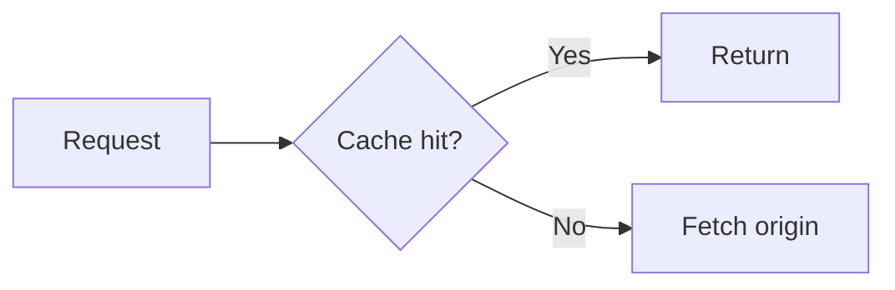

This is the Markdown dialect noteflow supports. Every section pairs the **source**
with **its rendering** in one box: what you write in a `.md` file on top, what it
becomes below. Only interested in the result? Read the lower half; look up to see
how it was written.

## Inline formatting

::: {.demo}
````markdown
**Bold**, *italic*, ***bold italic***, ~~strikethrough~~
`inline code`, ==highlighted==, H~2~O, x^2^
Underline with HTML: <u>underlined text</u>
````
**Bold**, *italic*, ***bold italic***, ~~strikethrough~~
`inline code`, ==highlighted==, H~2~O, x^2^
Underline with HTML: <u>underlined text</u>
:::

Smart punctuation (with `smart` on): typing `"quotes"`, `---`, `...` becomes
curly quotes, an em dash and an ellipsis.

Emoji shorts are converted too:

::: {.demo}
````markdown
:sparkles: :rocket: :warning: :memo:
````
:sparkles: :rocket: :warning: :memo:
:::

(Wrapping in backticks keeps it literal: `:sparkles:`)

## Headings and anchors

pandoc generates an `id` for every heading. Mixed-script headings get stable
anchors too.

### Custom ids and classes

::: {.demo}
````markdown
## A heading with a custom anchor {#my-anchor .accent}
````
## A heading with a custom anchor {#my-anchor .accent}
:::

`{#my-anchor}` overrides the auto id; `{.accent}` adds a class (styled in the
theme).

## Lists

::: {.demo}
````markdown
- An unordered list
  - one level in
    - and another level
- Another item

1. An ordered list
2. Second item
   - a mixed-in child

- [x] A completed task
- [ ] An open task
````
- An unordered list
  - one level in
    - and another level
- Another item

1. An ordered list
2. Second item
   - a mixed-in child

- [x] A completed task
- [ ] An open task
:::

## Blockquotes

::: {.demo}
````markdown
> An ordinary quote. It can span several lines,
> and hold a list inside:
>
> - First point
> - Second point
>
> — the attribution
````
> An ordinary quote. It can span several lines,
> and hold a list inside:
>
> - First point
> - Second point
>
> — the attribution
:::

## Callouts

Two spellings are equivalent; both normalize to the same colors.

### Fenced divs (recommended; custom titles)

::: {.demo}
````markdown
::: {.callout .note title="Supplementary note"}
The body supports **inline formatting**, `code` and lists.
:::

::: {.callout .tip}
Without a title, the type name becomes the title.
:::
````
::: {.callout .note title="Supplementary note"}
The body supports **inline formatting**, `code` and lists.
:::

::: {.callout .tip}
Without a title, the type name becomes the title.
:::
:::

### GFM alerts

::: {.demo}
````markdown
> [!NOTE]
> Blue: a plain remark

> [!TIP]
> Green: a tip

> [!WARNING]
> Orange: something to watch

> [!CAUTION]
> Red: a dangerous operation
````
> [!NOTE]
> Blue: a plain remark

> [!TIP]
> Green: a tip

> [!WARNING]
> Orange: something to watch

> [!CAUTION]
> Red: a dangerous operation
:::

Available types: `note`, `info`, `tip`, `success`, `warning`, `caution`,
`important`, `danger`.

## Tables

::: {.demo}
````markdown
| Left | Center | Right |
|:-----|:------:|------:|
| a    | b      | 1,234 |
| c    | d      | 5,678 |

: The table caption is the colon line under the table
````
| Left | Center | Right |
|:-----|:------:|------:|
| a    | b      | 1,234 |
| c    | d      | 5,678 |

: The table caption is the colon line under the table
:::

## Code blocks

Fenced code with a language tag is syntax-highlighted, with a copy button in the
corner.

::: {.demo}
````markdown
```js
const collator = new Intl.Collator('en', { numeric: true });
list.sort(collator.compare);
```
````
```js
const collator = new Intl.Collator('en', { numeric: true });
list.sort(collator.compare);
```
:::

Attributes work too: ```` ```{#my-code .numberLines} ```` shows line numbers.

::: {.demo}
````markdown
```python {.numberLines}
def greet(name):
    return f"Hello, {name}"
```
````
```python {.numberLines}
def greet(name):
    return f"Hello, {name}"
```
:::

A fence without a language (or with one the highlighter does not know) has no
highlighting, but the same frame and copy button:

::: {.demo}
````markdown
```
docker run --rm -it alpine sh
```
````
```
docker run --rm -it alpine sh
```
:::

Four leading spaces also make a code block, identical to a language-less fence:

::: {.demo}
````markdown
    const indented = () => {
        console.log('created by a four-space indent');
    };
````
    const indented = () => {
        console.log('created by a four-space indent');
    };
:::

Indented code works inside list items too (four spaces beyond the list content
column):

::: {.demo}
````markdown
- Step one: stage the changes

      git add .

- Step two: commit

      git commit -m "update"
````
- Step one: stage the changes

      git add .

- Step two: commit

      git commit -m "update"
:::

## Mathematics

Inline math uses `$...$`, display math `$$...$$`; the output is standard MathML.

::: {.demo}
````markdown
Inline mass–energy $E = mc^2$, and a display integral:

$$
\int_{0}^{1} x^2 \, dx = \frac{1}{3}
$$
````
Inline mass–energy $E = mc^2$, and a display integral:

$$
\int_{0}^{1} x^2 \, dx = \frac{1}{3}
$$
:::

Equations can carry a `\label`, referenced with `\ref` / `\eqref` (same page
only: texmath does not know either command, so the build adds ids and links
while numbering). `\tag{…}` overrides the displayed number; the counter still
advances:

::: {.demo}
````markdown
The mass–energy relation is $\ref{emc}$, that is $\eqref{emc}$.

$$
E = mc^2 \label{emc}
$$

$$
F = ma \tag{7}
$$
````
The mass–energy relation is $\ref{emc}$, that is $\eqref{emc}$.

$$
E = mc^2 \label{emc}
$$

$$
F = ma \tag{7}
$$
:::

## Links

::: {.demo}
````markdown
- Internal link: [Getting Started](./Getting%20Started.md)
- Internal link with an anchor: [the Pages anchor](./Deployment.md#github-pages)
- External link: [pandoc](https://pandoc.org)
- Bare link: https://example.com is autolinked
- Reference link: [pandoc][pd]; the definition can live anywhere in the file
````
- Internal link: [Getting Started](./Getting%20Started.md)
- Internal link with an anchor: [the Pages anchor](./Deployment.md#github-pages)
- External link: [pandoc](https://pandoc.org)
- Bare link: https://example.com is autolinked
- Reference link: [pandoc][pd]; the definition can live anywhere in the file
:::

[pd]: https://pandoc.org "the pandoc site"

### Link cards

An external link alone on a line, tagged `.link-preview`, renders as a card
with the site icon, title and description. The metadata is fetched **at build
time** and cached (`.cache/link-previews/`); the page itself makes no requests,
and a failed fetch or offline build degrades to a plain link. The link text is
the title fallback.

::: {.demo}
````markdown
[pandoc user's guide](https://pandoc.org/MANUAL.html){.link-preview}
````
[pandoc user's guide](https://pandoc.org/MANUAL.html){.link-preview}
:::

## Diagrams (Mermaid)

A code block tagged `mermaid` becomes a vector diagram in place. It is
pre-rendered to SVG at build time (the page loads no charting script), so it is
visible on first paint, zoomable, and follows the light and dark themes.

::: {.demo}
````markdown

````

:::

It also works as a fenced div, with a `caption` for a figure note:

::: {.demo}
````markdown
:::{.mermaid caption="The request/response handshake"}
sequenceDiagram
  participant Client
  participant Server
  Client->>Server: request
  Server-->>Client: response
:::
````
::: {.mermaid caption="The request/response handshake"}
sequenceDiagram
  participant Client
  participant Server
  Client->>Server: request
  Server-->>Client: response
:::
:::

Common mermaid diagram types are supported (flowchart, sequence, class, state,
Gantt, pie, ER, mindmap, timeline and more). Click a diagram to open the viewer:
drag to pan, scroll to zoom, double-click or press `0` to reset, `Esc` to close.

## Images

Images resolve relative to the note's directory and are copied into the output;
the build adds `loading="lazy"`. An image alone in its own paragraph shows its
`alt` text as a caption.

Diagrams and images share one viewer: it opens onto a full-screen dark
translucent backdrop that still hints at the text behind, with the media
floating in the middle. A thumbnail rail on the right lists every diagram and
image on the page (with a `1 / 3` counter at the top); click or press `←` `→` to
switch. Drag to pan, scroll to zoom, double-click to toggle between fit and
zoom, `0` to fit, `Esc` or a click on the backdrop to close. On phones the rail
becomes a bottom strip you can swipe. Opening and closing are overlays only: the
page's scroll position and layout never change.

::: {.demo}
````markdown


A small inline image stays inline: {width=32}
````


A small inline image stays inline: {width=24}
:::

## Audio and video

Media uses native HTML elements; the URLs resolve relative to the note's
directory and are copied into the output like images. The CSP is not relaxed:
media can only come from the site itself, and `autoplay` is not whitelisted, so
playback starts only on user action. Off-site Bilibili / YouTube videos use a
`.embed` link, swapped for the provider's player at build time.

::: {.demo}
````markdown
<video controls poster="./media/poster.png" width="480">
  <source src="./media/demo.webm" type="video/webm">
  <track src="./media/demo.vtt" kind="captions" srclang="en" label="English" default>
</video>

<audio controls src="./media/demo.wav"></audio>
````
<video controls poster="./media/poster.png" width="480">
  <source src="./media/demo.webm" type="video/webm">
  <track src="./media/demo.vtt" kind="captions" srclang="en" label="English" default>
</video>

<audio controls src="./media/demo.wav"></audio>
:::

### Bilibili / YouTube

A video-page link alone on a line, tagged `.embed`, renders as the provider's
player (`player.bilibili.com` / `www.youtube-nocookie.com`). Any other site, or
a URL that is not a video page, fails the build.

::: {.demo}
````markdown
[A demo video](https://www.bilibili.com/video/BV1j4411W7F7){.embed}
````
[A demo video](https://www.bilibili.com/video/BV1j4411W7F7){.embed}
:::

::: {.demo}
````markdown
[A YouTube demo](https://www.youtube.com/watch?v=KLuTLF3x9sA){.embed}
````
[A YouTube demo](https://www.youtube.com/watch?v=KLuTLF3x9sA){.embed}
:::

The supported types live in `ATTACHMENT_TYPES` (`src/render/attachments.ts`):
mp4/webm/ogv video, mp3/m4a/ogg/wav/flac audio, vtt subtitles. Media and
subtitles load only from this site; same-origin is enough, no CORS needed.

## Footnotes

::: {.demo}
````markdown
The mass–energy relation follows from special relativity.[^1]

[^1]: From the 1905 paper "On the Electrodynamics of Moving Bodies".
````
The mass–energy relation follows from special relativity.[^1]

[^1]: From the 1905 paper "On the Electrodynamics of Moving Bodies".
:::

## Definition lists

::: {.demo}
````markdown
Term
:   Its explanation, possibly several paragraphs long.

Second term
:   Its explanation.
````
Term
:   Its explanation, possibly several paragraphs long.

Second term
:   Its explanation.
:::

## Collapsible blocks and raw HTML

HTML is allowed by default; `<details>` is the common way to collapse content:

::: {.demo}
````markdown
<details>
<summary>Click to expand</summary>

The collapsed content lives here; it can use **Markdown**, but needs a blank
line after `<summary>`.

</details>
````
<details>
<summary>Click to expand</summary>

The collapsed content lives here; it can use **Markdown**, but needs a blank
line after `<summary>`.

</details>
:::

## Tabs

Several takes on one task nest into a tab group the reader picks from by
environment. It is a plain pandoc fenced div: `::: {.tabs}` opens a group,
each `::: {.tab data-title="Title"}` opens a panel, and each `:::` closes its
enclosing block.

::: {.demo}
````markdown
::: {.tabs}

::: {.tab data-title="npm"}

```bash
npm install lodash
```

:::

::: {.tab data-title="pnpm"}

```bash
pnpm add lodash
```

:::

:::
````
::: {.tabs}

::: {.tab data-title="npm"}

```bash
npm install lodash
```

:::

::: {.tab data-title="pnpm"}

```bash
pnpm add lodash
```

:::

:::
:::

Panel titles are plain text (in the `data-title` attribute); a panel holds any
block content (lists, tables, collapsibles, mermaid). Without scripting, every
panel renders stacked with its title, so nothing is lost.

## Columns

`::: {.columns}` with `::: {.column}` gives a simple side-by-side layout (equal
widths):

::: {.demo}
````markdown
:::: {.columns}
::: {.column}
The left column.
:::
::: {.column}
The right column.
:::
::::
````
:::: {.columns}
::: {.column}
The left column.
:::
::: {.column}
The right column.
:::
::::
:::

## Rules and escaping

::: {.demo}
````markdown
Three hyphens make a rule:

---

To print a literal, escape with a backslash: \*not italic\*, \`not code\`, and
a price of \$5.
````
Three hyphens make a rule:

---

To print a literal, escape with a backslash: \*not italic\*, \`not code\`, and
a price of \$5.
:::

## Unsupported or degraded constructs

| Construct | Result |
|---|---|
| A link to a private page | Replaced with "private page", never a dead link |
| An image in a private directory | Replaced with "private image" |
| `\LaTeX` macros | `raw_tex` is off, so they show as literal text |
| A raw attribute `{=html}` | `raw_attribute` is off, so it shows as literal text |
| Auto-wrapping a lone image in `<figure>` | `implicit_figures` is off; images keep inline semantics |