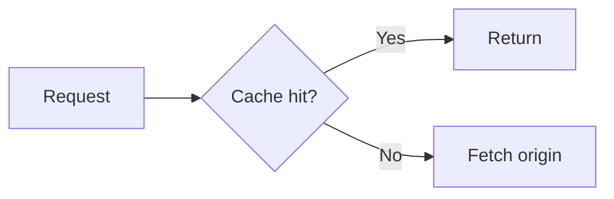

Constructs the builder adds on top of the [standard syntax](./Standard%20Markdown.md).
Most are ordinary pandoc fenced divs; the build gives them meaning and the theme
gives them shape.

# Callouts

Two spellings are equivalent; both normalize to the same colors.

## Fenced divs (recommended; custom titles)

::: {.demo}
````markdown
::: {.callout .note title="Supplementary note"}
The body supports **inline formatting**, `code` and lists.
:::

::: {.callout .tip}
Without a title, the type name becomes the title.
:::
````
::: {.callout .note title="Supplementary note"}
The body supports **inline formatting**, `code` and lists.
:::

::: {.callout .tip}
Without a title, the type name becomes the title.
:::
:::

## GFM alerts

::: {.demo}
````markdown
> [!NOTE]
> Blue: a plain remark

> [!TIP]
> Green: a tip

> [!WARNING]
> Orange: something to watch

> [!CAUTION]
> Red: a dangerous operation
````
> [!NOTE]
> Blue: a plain remark

> [!TIP]
> Green: a tip

> [!WARNING]
> Orange: something to watch

> [!CAUTION]
> Red: a dangerous operation
:::

Available types: `note`, `info`, `tip`, `success`, `warning`, `caution`,
`important`, `danger`.

# Link cards

An external link alone on a line, tagged `.link-preview`, renders as a card
with the site icon, title and description. The metadata is fetched **at build
time** and cached (`.cache/link-previews/`); the page itself makes no requests,
and a failed fetch or offline build degrades to a plain link. The link text is
the title fallback.

::: {.demo}
````markdown
[pandoc user's guide](https://pandoc.org/MANUAL.html){.link-preview}
````
[pandoc user's guide](https://pandoc.org/MANUAL.html){.link-preview}
:::

# Diagrams (Mermaid)

A code block tagged `mermaid` becomes a vector diagram in place. It is
pre-rendered to SVG at build time (the page loads no charting script), so it is
visible on first paint, zoomable, and follows the light and dark themes.

::: {.demo}
````markdown

````

:::

It also works as a fenced div, with a `caption` for a figure note:

::: {.demo}
````markdown
:::{.mermaid caption="The request/response handshake"}
sequenceDiagram
  participant Client
  participant Server
  Client->>Server: request
  Server-->>Client: response
:::
````
::: {.mermaid caption="The request/response handshake"}
sequenceDiagram
  participant Client
  participant Server
  Client->>Server: request
  Server-->>Client: response
:::
:::

Common mermaid diagram types are supported (flowchart, sequence, class, state,
Gantt, pie, ER, mindmap, timeline and more). The palette comes from the site's
`mermaid.theme` — one choice covers both light and dark. Click a diagram to
open the viewer: drag to pan, scroll to zoom, double-click or press `0` to
reset, `Esc` to close.

The drawing is the default view; the `Source` switch above it shows the Mermaid
that produced it, with a one-click copy. The source is part of the page — the
diagram still renders fully without scripting.

# Images

Images resolve relative to the note's directory and are copied into the output;
the build adds `loading="lazy"`. An image alone in its own paragraph shows its
`alt` text as a caption.

Diagrams and images share one viewer: it opens onto a full-screen dark
translucent backdrop that still hints at the text behind, with the media
floating in the middle. A thumbnail rail on the right lists every diagram and
image on the page (with a `1 / 3` counter at the top); click or press `←` `→` to
switch. Drag to pan, scroll to zoom, double-click to toggle between fit and
zoom, `0` to fit, `R` (or the toolbar button) to rotate a quarter turn — handy
for a photo shot sideways — `Esc` or a click on the backdrop to close. On phones
the rail becomes a bottom strip you can swipe. Opening and closing are overlays
only: the page's scroll position and layout never change.

::: {.demo}
````markdown


A small inline image stays inline: {width=32}
````


A small inline image stays inline: {width=24}
:::

# Audio and video

Media uses native HTML elements; the URLs resolve relative to the note's
directory and are copied into the output like images. The CSP is not relaxed:
media can only come from the site itself, and `autoplay` is not whitelisted, so
playback starts only on user action. Off-site Bilibili / YouTube videos use a
`.embed` link, swapped for the provider's player at build time.

::: {.demo}
````markdown
<video controls poster="./media/poster.png" width="480">
  <source src="./media/demo.webm" type="video/webm">
  <track src="./media/demo.vtt" kind="captions" srclang="en" label="English" default>
</video>

<audio controls src="./media/demo.wav"></audio>
````
<video controls poster="./media/poster.png" width="480">
  <source src="./media/demo.webm" type="video/webm">
  <track src="./media/demo.vtt" kind="captions" srclang="en" label="English" default>
</video>

<audio controls src="./media/demo.wav"></audio>
:::

## Bilibili / YouTube

A video-page link alone on a line, tagged `.embed`, renders as the provider's
player (`player.bilibili.com` / `www.youtube-nocookie.com`). Any other site, or
a URL that is not a video page, fails the build. Playback starts only when the
reader clicks play — the frame is never granted `autoplay`, and Bilibili's player
URL carries an explicit `autoplay=0`.

::: {.demo}
````markdown
[A demo video](https://www.bilibili.com/video/BV1j4411W7F7){.embed}
````
[A demo video](https://www.bilibili.com/video/BV1j4411W7F7){.embed}
:::

::: {.demo}
````markdown
[A YouTube demo](https://www.youtube.com/watch?v=KLuTLF3x9sA){.embed}
````
[A YouTube demo](https://www.youtube.com/watch?v=KLuTLF3x9sA){.embed}
:::

The supported types live in `ATTACHMENT_TYPES` (`src/render/attachments.ts`):
mp4/webm/ogv video, mp3/m4a/ogg/wav/flac audio, vtt subtitles. Media and
subtitles load only from this site; same-origin is enough, no CORS needed.

# Tabs

Several takes on one task nest into a tab group the reader picks from by
environment. It is a plain pandoc fenced div: `::: {.tabs}` opens a group,
each `::: {.tab data-title="Title"}` opens a panel, and each `:::` closes its
enclosing block.

::: {.demo}
````markdown
::: {.tabs}

::: {.tab data-title="npm"}

```bash
npm install lodash
```

:::

::: {.tab data-title="pnpm"}

```bash
pnpm add lodash
```

:::

:::
````
::: {.tabs}

::: {.tab data-title="npm"}

```bash
npm install lodash
```

:::

::: {.tab data-title="pnpm"}

```bash
pnpm add lodash
```

:::

:::
:::

Panel titles are plain text (in the `data-title` attribute); a panel holds any
block content (lists, tables, collapsibles, mermaid). Without scripting, every
panel renders stacked with its title, so nothing is lost.

# Columns

`::: {.columns}` with `::: {.column}` gives a simple side-by-side layout (equal
widths):

::: {.demo}
````markdown
:::: {.columns}
::: {.column}
The left column.
:::
::: {.column}
The right column.
:::
::::
````
:::: {.columns}
::: {.column}
The left column.
:::
::: {.column}
The right column.
:::
::::
:::

# Components

The theme ships a `w-` class layer — buttons, chips, cards and a timeline —
usable from Markdown alone, no script and no per-note CSS. Every piece reads the
theme tokens, so light and dark follow the site automatically.

::: {.demo}
````markdown
[Read the manual](./Standard%20Markdown.md){.w-btn} [Back home](/){.w-btn .w-ghost}

Status: [stable]{.w-chip} [v0.3]{.w-chip} [experimental]{.w-chip}
````
[Read the manual](./Standard%20Markdown.md){.w-btn} [Back home](/){.w-btn .w-ghost}

Status: [stable]{.w-chip} [v0.3]{.w-chip} [experimental]{.w-chip}
:::

Buttons are ordinary links (`{ .w-btn }`, add `.w-ghost` for the outline form);
chips are bracketed spans (`[text]{.w-chip}`). Both work inline in a sentence.

## Cards

A card is a fenced div; its body is full Markdown. A grid is another fenced div
layered around them, and the columns reflow by width (single column on phones):

::: {.demo}
````markdown
:::: {.w-grid}
::: {.w-card}
**Zero script** — a card is a fenced div; the body is ordinary Markdown.
:::

::: {.w-card}
**Follows the theme** — colors, corners and shadows are theme tokens.
:::
::::
````
:::: {.w-grid}
::: {.w-card}
**Zero script** — a card is a fenced div; the body is ordinary Markdown.
:::

::: {.w-card}
**Follows the theme** — colors, corners and shadows are theme tokens.
:::
::::
:::

## Timeline

Each `::: {.w-tl}` is one entry; the dot aligns to the entry's first line and
the rail runs down the `::: {.w-timeline}` group:

::: {.demo}
````markdown
::: {.w-timeline}
::: {.w-tl}
**v0.3** — the widget channel.
:::

::: {.w-tl}
**Next** — components landed in the theme.
:::
:::
````
::: {.w-timeline}
::: {.w-tl}
**v0.3** — the widget channel.
:::

::: {.w-tl}
**Next** — components landed in the theme.
:::
:::
:::

A `w-` class beyond these built-ins is not special: it only becomes meaningful
with an [interactive note](./Features.md#interactive-notes) that defines it.

# Interactive notes

A note can carry its own HTML, CSS and JavaScript, written straight into the
Markdown — buttons, sliders, `<canvas>`, SVG, a `<style>` block, an inline
`<script>`, `onclick` handlers. It runs. There is no component to install and no
fixed vocabulary to learn: you write the markup and the code you already know.

The CSP is what makes this possible: the build hashes every inline `<script>`,
`<style>` and `on…` handler it emits into the page's CSP, so exactly the bytes
you wrote are the bytes the browser is allowed to run — nothing loaded from
elsewhere, and no `eval`. The demo below puts the whole feature in one note: an inline
`<style>`, a `<canvas>` the script animates, palette buttons wired with
`onclick`, and a speed slider whose `input` event the author's code listens to.
Move the pointer over the field to pull the particles.

::: {.demo}
````markdown
<style>
  :root { --flow-p1: #0a6cd6; --flow-p2: #7c5cff; --flow-p3: #12b3a6; }
  .flow {
    position: relative;
    margin: 1.25rem 0;
    padding: 0.85rem;
    border: 1px solid var(--border);
    border-radius: var(--radius);
    background: var(--bg-elev);
    box-shadow: var(--shadow-sm);
  }
  .flow canvas {
    display: block;
    width: 100%;
    height: auto;
    aspect-ratio: 4 / 3;
    border-radius: var(--radius-xs);
    background: #07070c;
    touch-action: none;
    cursor: crosshair;
  }
  .flow-bar {
    display: flex;
    flex-wrap: wrap;
    align-items: center;
    gap: 0.55rem;
    margin-top: 0.75rem;
  }
  .flow-sw {
    width: 1.6rem;
    height: 1.6rem;
    padding: 0;
    border: 0;
    border-radius: 50%;
    cursor: pointer;
    box-shadow: 0 0 0 2px var(--bg-elev), 0 0 0 3px transparent;
    transition: box-shadow var(--dur) var(--ease), transform var(--dur) var(--ease);
  }
  .flow-sw:hover { transform: scale(1.12); }
  .flow-sw[aria-pressed="true"] {
    box-shadow: 0 0 0 2px var(--bg-elev), 0 0 0 3px var(--fg);
    transform: scale(1.12);
  }
  .flow-field {
    display: inline-flex;
    align-items: center;
    gap: 0.5rem;
    margin-left: auto;
    font-size: 0.82rem;
    color: var(--fg-muted);
  }
  .flow-field input { width: 7rem; accent-color: var(--flow-p1); }
  .flow-hint {
    margin: 0.5rem 0 0;
    color: var(--fg-subtle);
    font-size: 0.78rem;
  }
</style>

<div class="flow" id="flow">
<canvas id="flow-canvas" width="800" height="600" role="img" aria-label="A glowing field of particles that drift and gather toward the pointer"></canvas>
<div class="flow-bar">
<button type="button" class="flow-sw" style="background:var(--flow-p1)" aria-pressed="true" aria-label="Azure palette" onclick="__flow.palette(this,'azure')"></button>
<button type="button" class="flow-sw" style="background:#e0567a" aria-pressed="false" aria-label="Sunset palette" onclick="__flow.palette(this,'sunset')"></button>
<button type="button" class="flow-sw" style="background:#12b3a6" aria-pressed="false" aria-label="Lagoon palette" onclick="__flow.palette(this,'lagoon')"></button>
<label class="flow-field">Drift
<input type="range" id="flow-speed" min="0" max="100" value="45" aria-label="Particle drift speed">
</label>
</div>
<p class="flow-hint">Move the pointer to draw the particles in; the swatches recolor the field.</p>
</div>

<script>
  (function () {
    var host = document.getElementById("flow");
    if (!host || host.dataset.ready) return;
    host.dataset.ready = "1";

    var canvas = document.getElementById("flow-canvas");
    var ctx = canvas.getContext("2d");
    var PALS = {
      azure: ["#4c9aff", "#8b6bff", "#22d3c0"],
      sunset: ["#ff6f91", "#ffb056", "#a06bff"],
      lagoon: ["#1fe0c8", "#4c9aff", "#b6e84a"],
    };
    var pal = PALS.azure;
    var pointer = { x: 0, y: 0, on: false };
    var drift = 0.45;

    var N = 170;
    var ps = [];
    for (var i = 0; i < N; i++) {
      ps.push({
        a: Math.random() * Math.PI * 2,
        r: 0.05 + 0.92 * Math.pow(Math.random(), 0.55),
        v: (0.05 + Math.random() * 0.2) * (Math.random() < 0.15 ? -1 : 1),
        w: 0.04 + Math.random() * 0.12,
        hue: i % 3,
        x: 0, y: 0, seen: false,
      });
    }

    function hexA(hex, a) {
      var n = parseInt(hex.slice(1), 16);
      return "rgba(" + (n >> 16 & 255) + "," + (n >> 8 & 255) + "," + (n & 255) + "," + a + ")";
    }

    function resize() {
      var rect = canvas.getBoundingClientRect();
      var dpr = Math.min(window.devicePixelRatio || 1, 2);
      canvas.width = Math.max(1, Math.round(rect.width * dpr));
      canvas.height = Math.max(1, Math.round(rect.height * dpr));
      for (var k = 0; k < ps.length; k++) ps[k].seen = false;
    }

    function frame(t) {
      var w = canvas.width, h = canvas.height, cx = w / 2, cy = h / 2;
      var maxR = Math.min(w, h) * 0.46;
      var u = w / 800; // scale unit

      // Fade-to-black rather than clear: soft motion trails that glow.
      ctx.globalCompositeOperation = "source-over";
      ctx.fillStyle = "rgba(7,7,12,0.22)";
      ctx.fillRect(0, 0, w, h);

      // Additive glow for everything drawn on top.
      ctx.globalCompositeOperation = "lighter";

      for (var i = 0; i < ps.length; i++) {
        var o = ps[i];
        var wob = 1 + 0.06 * Math.sin(t * 0.0006 * o.w + i);
        var x = cx + Math.cos(o.a) * o.r * maxR * wob;
        var y = cy + Math.sin(o.a) * o.r * maxR * wob * 0.92;
        if (pointer.on) {
          var dx = pointer.x - x, dy = pointer.y - y;
          var d = Math.sqrt(dx * dx + dy * dy);
          var reach = maxR * 1.1;
          if (d < reach) {
            var pull = (1 - d / reach) * 0.09 * drift * 7;
            x += dx * pull;
            y += dy * pull;
          }
        }
        if (o.seen) {
          ctx.strokeStyle = hexA(pal[o.hue], 0.55);
          ctx.lineWidth = Math.max(1, 1.3 * u);
          ctx.beginPath();
          ctx.moveTo(o.x, o.y);
          ctx.lineTo(x, y);
          ctx.stroke();
        }
        // A bright dot per particle: the field reads as stars, not hairlines.
        ctx.fillStyle = hexA(pal[o.hue], 0.9);
        ctx.beginPath();
        ctx.arc(x, y, Math.max(1.1, 1.6 * u), 0, Math.PI * 2);
        ctx.fill();
        o.x = x; o.y = y; o.seen = true;
        o.a += o.v * (0.4 + drift) * 0.016;
      }

      if (pointer.on) {
        var g = ctx.createRadialGradient(pointer.x, pointer.y, 0, pointer.x, pointer.y, maxR * 0.55);
        g.addColorStop(0, hexA(pal[2], 0.55));
        g.addColorStop(0.4, hexA(pal[0], 0.18));
        g.addColorStop(1, "rgba(0,0,0,0)");
        ctx.fillStyle = g;
        ctx.fillRect(0, 0, w, h);
      }
      ctx.globalCompositeOperation = "source-over";
      requestAnimationFrame(frame);
    }

    canvas.addEventListener("pointermove", function (e) {
      var rect = canvas.getBoundingClientRect();
      pointer.x = (e.clientX - rect.left) * (canvas.width / rect.width);
      pointer.y = (e.clientY - rect.top) * (canvas.height / rect.height);
      pointer.on = true;
    });
    canvas.addEventListener("pointerleave", function () { pointer.on = false; });

    var speed = document.getElementById("flow-speed");
    speed.addEventListener("input", function () { drift = speed.value / 100; });

    window.__flow = {
      palette: function (btn, name) {
        pal = PALS[name] || pal;
        var sw = host.querySelectorAll(".flow-sw");
        for (var j = 0; j < sw.length; j++) sw[j].setAttribute("aria-pressed", "false");
        btn.setAttribute("aria-pressed", "true");
      },
    };

    window.addEventListener("resize", resize);
    resize();
    requestAnimationFrame(frame);
  })();
</script>
````
<style>
  :root { --flow-p1: #0a6cd6; --flow-p2: #7c5cff; --flow-p3: #12b3a6; }
  .flow {
    position: relative;
    margin: 1.25rem 0;
    padding: 0.85rem;
    border: 1px solid var(--border);
    border-radius: var(--radius);
    background: var(--bg-elev);
    box-shadow: var(--shadow-sm);
  }
  .flow canvas {
    display: block;
    width: 100%;
    height: auto;
    aspect-ratio: 4 / 3;
    border-radius: var(--radius-xs);
    background: #07070c;
    touch-action: none;
    cursor: crosshair;
  }
  .flow-bar {
    display: flex;
    flex-wrap: wrap;
    align-items: center;
    gap: 0.55rem;
    margin-top: 0.75rem;
  }
  .flow-sw {
    width: 1.6rem;
    height: 1.6rem;
    padding: 0;
    border: 0;
    border-radius: 50%;
    cursor: pointer;
    box-shadow: 0 0 0 2px var(--bg-elev), 0 0 0 3px transparent;
    transition: box-shadow var(--dur) var(--ease), transform var(--dur) var(--ease);
  }
  .flow-sw:hover { transform: scale(1.12); }
  .flow-sw[aria-pressed="true"] {
    box-shadow: 0 0 0 2px var(--bg-elev), 0 0 0 3px var(--fg);
    transform: scale(1.12);
  }
  .flow-field {
    display: inline-flex;
    align-items: center;
    gap: 0.5rem;
    margin-left: auto;
    font-size: 0.82rem;
    color: var(--fg-muted);
  }
  .flow-field input { width: 7rem; accent-color: var(--flow-p1); }
  .flow-hint {
    margin: 0.5rem 0 0;
    color: var(--fg-subtle);
    font-size: 0.78rem;
  }
</style>

<div class="flow" id="flow">
<canvas id="flow-canvas" width="800" height="600" role="img" aria-label="A glowing field of particles that drift and gather toward the pointer"></canvas>
<div class="flow-bar">
<button type="button" class="flow-sw" style="background:var(--flow-p1)" aria-pressed="true" aria-label="Azure palette" onclick="__flow.palette(this,'azure')"></button>
<button type="button" class="flow-sw" style="background:#e0567a" aria-pressed="false" aria-label="Sunset palette" onclick="__flow.palette(this,'sunset')"></button>
<button type="button" class="flow-sw" style="background:#12b3a6" aria-pressed="false" aria-label="Lagoon palette" onclick="__flow.palette(this,'lagoon')"></button>
<label class="flow-field">Drift
<input type="range" id="flow-speed" min="0" max="100" value="45" aria-label="Particle drift speed">
</label>
</div>
<p class="flow-hint">Move the pointer to draw the particles in; the swatches recolor the field.</p>
</div>

<script>
  (function () {
    var host = document.getElementById("flow");
    if (!host || host.dataset.ready) return;
    host.dataset.ready = "1";

    var canvas = document.getElementById("flow-canvas");
    var ctx = canvas.getContext("2d");
    var PALS = {
      azure: ["#4c9aff", "#8b6bff", "#22d3c0"],
      sunset: ["#ff6f91", "#ffb056", "#a06bff"],
      lagoon: ["#1fe0c8", "#4c9aff", "#b6e84a"],
    };
    var pal = PALS.azure;
    var pointer = { x: 0, y: 0, on: false };
    var drift = 0.45;

    var N = 170;
    var ps = [];
    for (var i = 0; i < N; i++) {
      ps.push({
        a: Math.random() * Math.PI * 2,
        r: 0.05 + 0.92 * Math.pow(Math.random(), 0.55),
        v: (0.05 + Math.random() * 0.2) * (Math.random() < 0.15 ? -1 : 1),
        w: 0.04 + Math.random() * 0.12,
        hue: i % 3,
        x: 0, y: 0, seen: false,
      });
    }

    function hexA(hex, a) {
      var n = parseInt(hex.slice(1), 16);
      return "rgba(" + (n >> 16 & 255) + "," + (n >> 8 & 255) + "," + (n & 255) + "," + a + ")";
    }

    function resize() {
      var rect = canvas.getBoundingClientRect();
      var dpr = Math.min(window.devicePixelRatio || 1, 2);
      canvas.width = Math.max(1, Math.round(rect.width * dpr));
      canvas.height = Math.max(1, Math.round(rect.height * dpr));
      for (var k = 0; k < ps.length; k++) ps[k].seen = false;
    }

    function frame(t) {
      var w = canvas.width, h = canvas.height, cx = w / 2, cy = h / 2;
      var maxR = Math.min(w, h) * 0.46;
      var u = w / 800; // scale unit

      // Fade-to-black rather than clear: soft motion trails that glow.
      ctx.globalCompositeOperation = "source-over";
      ctx.fillStyle = "rgba(7,7,12,0.22)";
      ctx.fillRect(0, 0, w, h);

      // Additive glow for everything drawn on top.
      ctx.globalCompositeOperation = "lighter";

      for (var i = 0; i < ps.length; i++) {
        var o = ps[i];
        var wob = 1 + 0.06 * Math.sin(t * 0.0006 * o.w + i);
        var x = cx + Math.cos(o.a) * o.r * maxR * wob;
        var y = cy + Math.sin(o.a) * o.r * maxR * wob * 0.92;
        if (pointer.on) {
          var dx = pointer.x - x, dy = pointer.y - y;
          var d = Math.sqrt(dx * dx + dy * dy);
          var reach = maxR * 1.1;
          if (d < reach) {
            var pull = (1 - d / reach) * 0.09 * drift * 7;
            x += dx * pull;
            y += dy * pull;
          }
        }
        if (o.seen) {
          ctx.strokeStyle = hexA(pal[o.hue], 0.55);
          ctx.lineWidth = Math.max(1, 1.3 * u);
          ctx.beginPath();
          ctx.moveTo(o.x, o.y);
          ctx.lineTo(x, y);
          ctx.stroke();
        }
        // A bright dot per particle: the field reads as stars, not hairlines.
        ctx.fillStyle = hexA(pal[o.hue], 0.9);
        ctx.beginPath();
        ctx.arc(x, y, Math.max(1.1, 1.6 * u), 0, Math.PI * 2);
        ctx.fill();
        o.x = x; o.y = y; o.seen = true;
        o.a += o.v * (0.4 + drift) * 0.016;
      }

      if (pointer.on) {
        var g = ctx.createRadialGradient(pointer.x, pointer.y, 0, pointer.x, pointer.y, maxR * 0.55);
        g.addColorStop(0, hexA(pal[2], 0.55));
        g.addColorStop(0.4, hexA(pal[0], 0.18));
        g.addColorStop(1, "rgba(0,0,0,0)");
        ctx.fillStyle = g;
        ctx.fillRect(0, 0, w, h);
      }
      ctx.globalCompositeOperation = "source-over";
      requestAnimationFrame(frame);
    }

    canvas.addEventListener("pointermove", function (e) {
      var rect = canvas.getBoundingClientRect();
      pointer.x = (e.clientX - rect.left) * (canvas.width / rect.width);
      pointer.y = (e.clientY - rect.top) * (canvas.height / rect.height);
      pointer.on = true;
    });
    canvas.addEventListener("pointerleave", function () { pointer.on = false; });

    var speed = document.getElementById("flow-speed");
    speed.addEventListener("input", function () { drift = speed.value / 100; });

    window.__flow = {
      palette: function (btn, name) {
        pal = PALS[name] || pal;
        var sw = host.querySelectorAll(".flow-sw");
        for (var j = 0; j < sw.length; j++) sw[j].setAttribute("aria-pressed", "false");
        btn.setAttribute("aria-pressed", "true");
      },
    };

    window.addEventListener("resize", resize);
    resize();
    requestAnimationFrame(frame);
  })();
</script>
:::

What works: any inline `<script>` body (classic script — not `type="module"`),
any `<style>` block, any `style="…"` attribute, `on*` handlers, `<button>`,
`<select>`, `<input>`, `<textarea>`, `<dialog>`, `<canvas>`, `<svg>` with its
shapes, any class name, `data-*`/`aria-*`. Style values are the only tightened
corner: a value that decodes to `url()`, `image-set()`, `expression()` or
`@import` fails the build, so CSS cannot fetch or execute (`u\72l(…)` counts —
the escape is decoded before the check). Draw and animate inline instead. The
theme tokens (`--accent`, `--bg`, `--border`, …) reach inline CSS too, and
`data-theme` on `<html>` follows the light/dark switch.

Two things differ from a plain web page under this CSP:

- **No `eval`.** `new Function`, string `setTimeout`, and `eval` are blocked.
  Ordinary DOM code, event wiring and canvas/SVG drawing need none of them; a
  few framework runtimes do, and those belong in a [widget file](#interactive-notes-with-a-file).
- **No `type="module"`.** Inline module bodies are dropped (their imports would
  need resolution the channel does not do). Write a classic IIFE, or ship a
  module as a file.

Inline code re-runs on a soft navigation (the site's client-side page swap),
so a script re-executes each time its note is entered — write it to re-obtain
its elements (`getElementById`) at run time rather than caching them once.

**Keep block HTML at the left margin.** Pandoc reads a line indented by four
or more spaces inside an HTML block as an indented *code* block, so a
`<button>` you aligned under `<div>` with four spaces ships as visible
`<button>…</button>` text instead of a live control. Indent inside `<style>` and
`<script>` freely — those bodies are raw text — but line up the tags at column 0.

## Interactive notes, with a file

When the code is large or shared by several notes, put it in a `.js` (and
optionally a `.css`) next to the note and reference it — the build publishes
these same-origin under `/assets/` and rewrites the references. This is the
same CSP (a `src` script is `script-src 'self'`; no hash needed), and it is the
only form that supports `type="module"` and importing other files.

::: {.demo}
````markdown
<link rel="stylesheet" href="./widgets/orbit.css">
<div class="w-orbit" role="img" aria-label="Interactive particle orbit"></div>
<script src="./widgets/orbit.js" defer></script>
````
<link rel="stylesheet" href="./widgets/orbit.css">
<div class="w-orbit" role="img" aria-label="Interactive particle orbit"></div>
<script src="./widgets/orbit.js" defer></script>
:::

Move the pointer over the field — particles near it light up and accelerate.

The rules of the file form:

- `<script src="…">` must point at a **relative** `.js` file and carry **no
  body**; `defer` is optional (and recommended). `<link rel="stylesheet"
  href="…">` must point at a relative `.css` file.
- External URLs (a `src`/`href` that leaves the site) are dropped. An inline
  body on a `src` script is ignored. A missing file fails the build, exactly
  like a broken image link.
- The mount element's class can be anything now (channel 2 admits any class);
  the `w-` namespace is still the convention for the theme's own pieces, so
  `grep w-` finds the site's built-in hooks.
- A widget script re-runs every time the page is soft-navigated to, so write
  it as an idempotent initializer: find its mounts (`querySelectorAll`) at run
  time and gate animation on visibility, never on "first load".

Either way, the code is ordinary browser code: the theme stays in reach via the
`--accent` / `--fg` / `--border` tokens (and `data-theme` on `<html>` for the
light/dark switch).