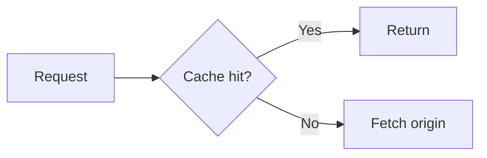

Constructs the builder adds on top of the [standard syntax](./Standard%20Markdown.md).
Most are ordinary pandoc fenced divs; the build gives them meaning and the theme
gives them shape.

# Callouts

Two spellings are equivalent; both normalize to the same colors.

## Fenced divs (recommended; custom titles)

::: {.demo}
````markdown
::: {.callout .note title="Supplementary note"}
The body supports **inline formatting**, `code` and lists.
:::

::: {.callout .tip}
Without a title, the type name becomes the title.
:::
````
::: {.callout .note title="Supplementary note"}
The body supports **inline formatting**, `code` and lists.
:::

::: {.callout .tip}
Without a title, the type name becomes the title.
:::
:::

## GFM alerts

::: {.demo}
````markdown
> [!NOTE]
> Blue: a plain remark

> [!TIP]
> Green: a tip

> [!WARNING]
> Orange: something to watch

> [!CAUTION]
> Red: a dangerous operation
````
> [!NOTE]
> Blue: a plain remark

> [!TIP]
> Green: a tip

> [!WARNING]
> Orange: something to watch

> [!CAUTION]
> Red: a dangerous operation
:::

Available types: `note`, `info`, `tip`, `success`, `warning`, `caution`,
`important`, `danger`.

# Link cards

An external link alone on a line, tagged `.link-preview`, renders as a card
with the site icon, title and description. The metadata is fetched **at build
time** and cached (`.cache/link-previews/`); the page itself makes no requests,
and a failed fetch or offline build degrades to a plain link. The link text is
the title fallback.

::: {.demo}
````markdown
[pandoc user's guide](https://pandoc.org/MANUAL.html){.link-preview}
````
[pandoc user's guide](https://pandoc.org/MANUAL.html){.link-preview}
:::

# Diagrams (Mermaid)

A code block tagged `mermaid` becomes a vector diagram in place. It is
pre-rendered to SVG at build time (the page loads no charting script), so it is
visible on first paint, zoomable, and follows the light and dark themes.

::: {.demo}
````markdown

````

:::

It also works as a fenced div, with a `caption` for a figure note:

::: {.demo}
````markdown
:::{.mermaid caption="The request/response handshake"}
sequenceDiagram
  participant Client
  participant Server
  Client->>Server: request
  Server-->>Client: response
:::
````
::: {.mermaid caption="The request/response handshake"}
sequenceDiagram
  participant Client
  participant Server
  Client->>Server: request
  Server-->>Client: response
:::
:::

Common mermaid diagram types are supported (flowchart, sequence, class, state,
Gantt, pie, ER, mindmap, timeline and more). The palette comes from the site's
`mermaid.theme` — one choice covers both light and dark. Click a diagram to
open the viewer: drag to pan, scroll to zoom, double-click or press `0` to
reset, `Esc` to close.

The drawing is the default view; the `Source` switch above it shows the Mermaid
that produced it, with a one-click copy. The source is part of the page — the
diagram still renders fully without scripting.

# Images

Images resolve relative to the note's directory and are copied into the output;
the build adds `loading="lazy"`. An image alone in its own paragraph shows its
`alt` text as a caption.

Diagrams and images share one viewer: it opens onto a full-screen dark
translucent backdrop that still hints at the text behind, with the media
floating in the middle. A thumbnail rail on the right lists every diagram and
image on the page (with a `1 / 3` counter at the top); click or press `←` `→` to
switch. Drag to pan, scroll to zoom, double-click to toggle between fit and
zoom, `0` to fit, `R` (or the toolbar button) to rotate a quarter turn — handy
for a photo shot sideways — `Esc` or a click on the backdrop to close. On phones
the rail becomes a bottom strip you can swipe. Opening and closing are overlays
only: the page's scroll position and layout never change.

::: {.demo}
````markdown


A small inline image stays inline: {width=32}
````


A small inline image stays inline: {width=24}
:::

# Audio and video

Media uses native HTML elements; the URLs resolve relative to the note's
directory and are copied into the output like images. The CSP is not relaxed:
media can only come from the site itself, and `autoplay` is not whitelisted, so
playback starts only on user action. Off-site Bilibili / YouTube videos use a
`.embed` link, swapped for the provider's player at build time.

::: {.demo}
````markdown
<video controls poster="./media/poster.png" width="480">
  <source src="./media/demo.webm" type="video/webm">
  <track src="./media/demo.vtt" kind="captions" srclang="en" label="English" default>
</video>

<audio controls src="./media/demo.wav"></audio>
````
<video controls poster="./media/poster.png" width="480">
  <source src="./media/demo.webm" type="video/webm">
  <track src="./media/demo.vtt" kind="captions" srclang="en" label="English" default>
</video>

<audio controls src="./media/demo.wav"></audio>
:::

## Bilibili / YouTube

A video-page link alone on a line, tagged `.embed`, renders as the provider's
player (`player.bilibili.com` / `www.youtube-nocookie.com`). Any other site, or
a URL that is not a video page, fails the build. Playback starts only when the
reader clicks play — the frame is never granted `autoplay`, and Bilibili's player
URL carries an explicit `autoplay=0`.

::: {.demo}
````markdown
[A demo video](https://www.bilibili.com/video/BV1j4411W7F7){.embed}
````
[A demo video](https://www.bilibili.com/video/BV1j4411W7F7){.embed}
:::

::: {.demo}
````markdown
[A YouTube demo](https://www.youtube.com/watch?v=KLuTLF3x9sA){.embed}
````
[A YouTube demo](https://www.youtube.com/watch?v=KLuTLF3x9sA){.embed}
:::

The supported types live in `ATTACHMENT_TYPES` (`src/render/attachments.ts`):
mp4/webm/ogv video, mp3/m4a/ogg/wav/flac audio, vtt subtitles. Media and
subtitles load only from this site; same-origin is enough, no CORS needed.

# Tabs

Several takes on one task nest into a tab group the reader picks from by
environment. It is a plain pandoc fenced div: `::: {.tabs}` opens a group,
each `::: {.tab data-title="Title"}` opens a panel, and each `:::` closes its
enclosing block.

::: {.demo}
````markdown
::: {.tabs}

::: {.tab data-title="npm"}

```bash
npm install lodash
```

:::

::: {.tab data-title="pnpm"}

```bash
pnpm add lodash
```

:::

:::
````
::: {.tabs}

::: {.tab data-title="npm"}

```bash
npm install lodash
```

:::

::: {.tab data-title="pnpm"}

```bash
pnpm add lodash
```

:::

:::
:::

Panel titles are plain text (in the `data-title` attribute); a panel holds any
block content (lists, tables, collapsibles, mermaid). Without scripting, every
panel renders stacked with its title, so nothing is lost.

# Columns

`::: {.columns}` with `::: {.column}` gives a simple side-by-side layout (equal
widths):

::: {.demo}
````markdown
:::: {.columns}
::: {.column}
The left column.
:::
::: {.column}
The right column.
:::
::::
````
:::: {.columns}
::: {.column}
The left column.
:::
::: {.column}
The right column.
:::
::::
:::

# Components

The theme ships a `w-` class layer — buttons, chips, cards, a timeline and a
scroll-reveal — usable from Markdown alone, no script and no per-note CSS. Every
piece reads the theme tokens, so light and dark follow the site automatically.

::: {.demo}
````markdown
[Read the manual](./Standard%20Markdown.md){.w-btn} [Back home](/){.w-btn .w-ghost}

Status: [stable]{.w-chip} [v0.3]{.w-chip} [experimental]{.w-chip}
````
[Read the manual](./Standard%20Markdown.md){.w-btn} [Back home](/){.w-btn .w-ghost}

Status: [stable]{.w-chip} [v0.3]{.w-chip} [experimental]{.w-chip}
:::

Buttons are ordinary links (`{ .w-btn }`, add `.w-ghost` for the outline form);
chips are bracketed spans (`[text]{.w-chip}`). Both work inline in a sentence.

## Cards

A card is a fenced div; its body is full Markdown. A grid is another fenced div
layered around them, and the columns reflow by width (single column on phones):

::: {.demo}
````markdown
:::: {.w-grid}
::: {.w-card}
**Zero script** — a card is a fenced div; the body is ordinary Markdown.
:::

::: {.w-card}
**Follows the theme** — colors, corners and shadows are theme tokens.
:::
::::
````
:::: {.w-grid}
::: {.w-card}
**Zero script** — a card is a fenced div; the body is ordinary Markdown.
:::

::: {.w-card}
**Follows the theme** — colors, corners and shadows are theme tokens.
:::
::::
:::

## Timeline

Each `::: {.w-tl}` is one entry; the dot aligns to the entry's first line and
the rail runs down the `::: {.w-timeline}` group:

::: {.demo}
````markdown
::: {.w-timeline}
::: {.w-tl}
**2026-11-21** — the widget channel shipped.
:::

::: {.w-tl}
**Next** — components landed in the theme.
:::
:::
````
::: {.w-timeline}
::: {.w-tl}
**2026-11-21** — the widget channel shipped.
:::

::: {.w-tl}
**Next** — components landed in the theme.
:::
:::
:::

## Scroll-reveal

Tag a block `.w-reveal` and it fades up as it enters the viewport; wrap a group
in `.w-stagger` to offset each child. This is the one scripted upgrade: the CSS
hides a block only under `html[data-js]`, so without scripting (or in print)
everything is simply visible, and `prefers-reduced-motion` skips the fade.

::: {.demo}
````markdown
::: {.w-reveal}
A block that fades in when scrolled into view.
:::

:::: {.w-stagger}
::: {.w-card .w-reveal}
Together, these appear one after another.
:::

::: {.w-card .w-reveal}
Second card.
:::
::::
````
::: {.w-reveal}
A block that fades in when scrolled into view.
:::

:::: {.w-stagger}
::: {.w-card .w-reveal}
Together, these appear one after another.
:::

::: {.w-card .w-reveal}
Second card.
:::
::::
:::

A `w-` class beyond these built-ins is not special: it only becomes meaningful
with a [widget](./Features.md#widgets) of the same name next to the note.

# Widgets

A note can run small interactive widgets of its own: drop a `.js` (and
optionally a `.css`) next to the note, then reference them with plain HTML —
the build publishes the files same-origin under `/assets/` and rewrites the
references. The CSP is not relaxed: scripts and styles load from this site
only, so pasted embeds from elsewhere stay inert.

::: {.demo}
````markdown
<link rel="stylesheet" href="./widgets/orbit.css">
<div class="w-orbit" role="img" aria-label="Interactive particle orbit"></div>
<script src="./widgets/orbit.js" defer></script>
````
<link rel="stylesheet" href="./widgets/orbit.css">
<div class="w-orbit" role="img" aria-label="Interactive particle orbit"></div>
<script src="./widgets/orbit.js" defer></script>
:::

Move the pointer over the field — particles near it light up and accelerate.

The rules of the channel:

- `<script src="…">` must point at a **relative** `.js` file and carry **no
  body**; `defer` is optional (and recommended). `<link rel="stylesheet"
  href="…">` must point at a relative `.css` file.
- Anything else — inline code (`<script>alert(1)</script>`), external URLs,
  `on*` handlers — is dropped at build time. The one spelling that ships is
  the one you wrote on purpose.
- The mount element's class must live in the `w-` namespace (`w-orbit`,
  `w-clock`, …); any other class is filtered as usual.
- A missing file fails the build, exactly like a broken image link.
- A widget script re-runs every time the page is soft-navigated to, so write
  it as an idempotent initializer: find its mounts (`querySelectorAll`) at run
  time and gate animation on visibility, never on "first load".

The widget itself is ordinary, CSP-clean code: build DOM with
`createElement`, style through the companion stylesheet or `element.style`,
and the theme stays in reach via the `--accent` / `--fg` / `--border` tokens
(and `data-theme` on `<html>` for the light/dark switch).